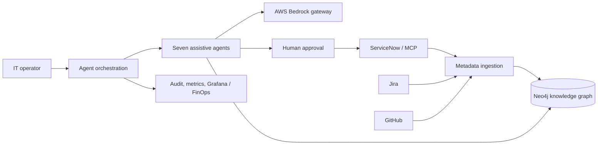
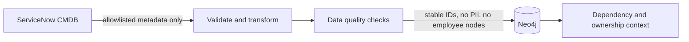
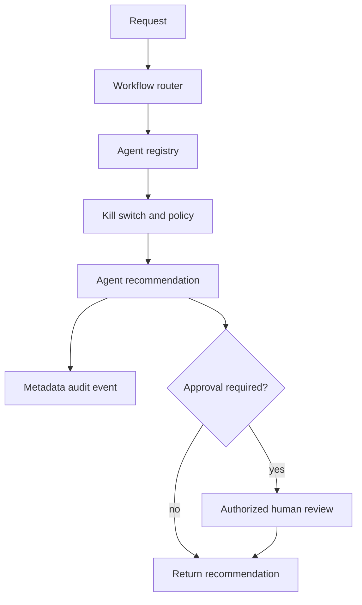
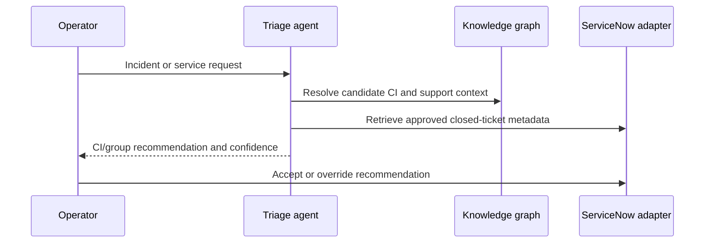
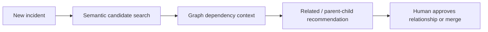
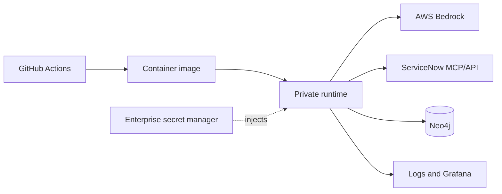

# Baxter–TCS AI Transformation Starter

Mock-first Python foundation for enterprise ITSM automation, a metadata-only knowledge graph, and seven assistive agent patterns.

> **Source limitation:** The requested `Baxter-TCS Transformation - AI Implementation.pdf` was not present in the workspace or supplied attachment directory. This repository is based only on the task prompt. It does not claim fidelity to that document; annual workflow volumes, committed scope, and document-specific platform decisions remain unverified. No real Baxter/TCS records or credentials are included.

## Objectives and operating principles

The starter illustrates AI-assisted IT operations: reduce repetitive work, improve ticket routing and knowledge quality, surface operational insights, and provide controlled recommendations. It follows Assist mode by default. Sensitive actions and external communications require human review. Real autonomy requires evaluation and governance approval.

## Architecture







### Ticket triaging workflow



### Incident correlation workflow



### Deployment architecture



## Seven agents

| Agent | Starter behavior | Production gap |
|---|---|---|
| Debt profiler | Counts declared debt types and prioritizes categories | Historical data pipeline, validated taxonomy, scheduled weekly/monthly jobs |
| Ticket triaging | Deterministic demo group recommendation, confidence, override support | CMDB resolution, similarity model, ServiceNow UI/workflow |
| Incident correlator | Returns supplied candidate incidents for human review | Semantic retrieval, graph traversal, approved merge API |
| Analytics & insight | Flags supplied aged and unassigned tickets | Pandas/PySpark datasets, dashboard and bulk-action controls |
| MIM assistance | Draft summary, handoff, stakeholder note, timeline and RCA | Validated templates, live timeline, communications controls |
| Autonomous SLA adherence | Flags supplied SLA-risk tickets; recommends escalation/swarming | Event/clock integration, calibrated prediction, autonomy approvals |
| Knowledge validation | Drafts review prompt and identifies owner-approval requirement | Article/resolution comparison, freshness rules, publishing workflow |

These are functional, deterministic examples with typed contracts. They are not trained AI models or production integrations. The default implementation cannot mutate external systems.

## Technology and repository map

Python 3.12, `uv`, LangGraph (optional orchestration adapter), AWS Bedrock, Neo4j/Bloom, ServiceNow MCP, Jira, GitHub, PySpark/Pandas, Ragas, Grafana/FinOps, Docker. The core demo uses only the standard library; optional dependencies are declared in `pyproject.toml`.

Key areas: `src/baxter_ai/agents` (agent implementations), `knowledge_graph` (allowlisted metadata and mock hydration), `integrations` (ports and mocks), `orchestration` (routing and approval queue), `governance.py`, `tests`, and `docs`.

## Prerequisites and setup

Install Python 3.12 and [uv](https://docs.astral.sh/uv/). A virtual environment was created in this workspace at `.venv` using `uv venv --python 3.12 .venv`.

```powershell
uv sync --extra dev
Copy-Item .env.example .env
uv run python -m baxter_ai
uv run pytest
```

For all optional integrations: `uv sync --extra all --extra dev`. Install only the extras needed by your environment. Copy `.env.example` and supply secrets through an approved secret manager; never commit `.env`.

## Docker

```powershell
Copy-Item .env.example .env
docker compose up --build
```

The compose file starts a local Neo4j community instance for development. Configure actual credentials and network controls before any shared deployment. Neo4j Bloom is a separately licensed/hosted visualization and is not included in this compose setup.

## Integrations

`MockServiceNow` and `MockModelGateway` let contributors run locally without credentials. Replace these behind the provided ports with approved ServiceNow MCP/API and Bedrock adapters. Neo4j connectivity is optional (`uv sync --extra graph`). Jira and GitHub are planned adapter boundaries; production OAuth, scopes, endpoints, and approval must be supplied by platform owners. Use least privilege and non-production tenants during integration work.

## Security and governance

The graph validator rejects free-text/PII-like fields and employee nodes are not part of the ontology. This is a starter safeguard, not a complete DLP control. Agent actions are recommendations; the kill switch, role policy, approval queue, and metadata-only audit helper illustrate controls but do not replace enterprise IAM, durable approvals, SIEM, retention policy, threat modeling, or security testing. External communications, merges, publication, reassignment, and escalation need human approval until governance approves otherwise.

## Tests and evaluation

`tests/` covers agent registry and behavior, kill switch, mock CMDB hydration, graph data validation, and routing. Evaluation datasets, Ragas runners, and calibrated performance reports require approved, de-identified data and should be added before model selection. Track routing accuracy, duplicate detection accuracy, SLA prediction quality, knowledge validation quality, human override rate, and execution success rate; establish baselines and acceptance thresholds with owners.

## Roadmap

1. Obtain the source PDF and reconcile requirements, committed workflows, execution volumes, platform choices, and ownership.
2. Approve ontology, data contracts, source access, and CMDB quality rules.
3. Add secured ServiceNow MCP and Neo4j adapters; validate metadata-only ingestion.
4. Run Assist-mode agents against approved evaluation sets and record Ragas/task metrics.
5. Add LangGraph state/persistence, observability, durable approval integration, and recovery behavior.
6. Pilot by workflow with Baxter/TCS owners; approve higher autonomy only after governance review.

## Contributions and license

See [CONTRIBUTING.md](CONTRIBUTING.md). `LICENSE` is an explicit placeholder, not a grant of rights. Confirm ownership and approved licensing before making this repository public.
